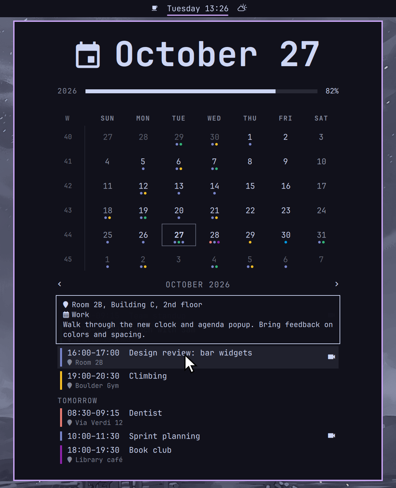

# Clock & Agenda

An Omarchy bar clock whose popup shows a month calendar with ISO week numbers
and your Google Calendar events.



- Days get a colored dot per event, in the event's Google Calendar color; hover to list them.
- Below the month: an agenda of the next seven days, or the events of a clicked day,
  with time range, location, calendar, description, and video-call link
  (Meet, Zoom, Teams, Webex).
- Hidden calendars and declined events are skipped; recurring events are expanded.

Based on Omarchy's built-in `omarchy.clock`. It replaces it in the bar.

Google Calendar is optional: without it the plugin works as a plain clock and calendar.

## Install

```bash
omarchy plugin add https://github.com/axpico/omarchy-clock-agenda --enable
```

Enabling it replaces `omarchy.clock` in the bar, in the same spot and with the same `format`.
If asked which bar section to use, pick `center` to keep the clock where it was.

The swap does not touch `centerAnchor`. If it points at the clock, update it in
`~/.config/omarchy/shell.json`:

```json
"bar": {
  "centerAnchor": "axpico.clock"
}
```

The shell reloads `shell.json` on save.

## Connect Google Calendar

The plugin reuses the login of [gcalcli](https://github.com/insanum/gcalcli),
so there is one Google sign-in to set up and nothing for the plugin to store.
Google requires every app to use its own OAuth client, so you create one
in a free Google Cloud project. It takes about five minutes, once.

### 1. Install the dependencies

```bash
omarchy pkg add gcalcli python-google-api-python-client
```

### 2. Create a Google Cloud project with the Calendar API

1. Open [Create a project](https://console.cloud.google.com/projectcreate),
   name it anything (e.g. `omarchy-calendar`), and click **Create**.
2. Open the [Google Calendar API](https://console.cloud.google.com/apis/library/calendar-json.googleapis.com)
   page, check the new project is selected at the top, and click **Enable**.

### 3. Set up the consent screen

1. Open [Google Auth Platform → Branding](https://console.cloud.google.com/auth/branding)
   and click **Get started**.
2. App name: anything (e.g. `gcalcli`). Support and contact email: your Gmail address.
   Audience: **External**. Finish the wizard.
3. Open [Audience](https://console.cloud.google.com/auth/audience):
   - Under **Test users**, add your Gmail address.
   - Click **Publish app** and confirm. See [Why publish](#why-publish-the-app) below.

### 4. Create the OAuth client

1. Open [Clients](https://console.cloud.google.com/auth/clients) and click **Create client**.
2. Application type: **Desktop app**. Name: anything. Click **Create**.
3. Copy the **Client ID** (`…apps.googleusercontent.com`) and the **Client secret**.

### 5. Sign in with gcalcli

```bash
gcalcli --client-id=YOUR_CLIENT_ID.apps.googleusercontent.com init
```

Paste the client secret when asked. A browser opens: pick your account.
Google warns that it "hasn't verified this app". That is your own app:
click **Advanced → Go to gcalcli (unsafe)**, then allow calendar access.

Check it worked:

```bash
gcalcli list
```

### 6. Done

Open the clock popup. Events appear within a few seconds.
To check by hand, run the plugin's script for a date range:

```bash
/usr/bin/python3 ~/.config/omarchy/plugins/axpico.clock/gcal-events.py 2026-01-01 2026-02-01
```

It prints your events as tab-separated rows, or the reason it can't.

### Why publish the app?

While a Google Cloud app is in **Testing**, Google expires its logins after
7 days, so the events would vanish every week until you run `gcalcli init` again.
A published app keeps the login. Publishing does not make anything public:
only accounts you sign in with can use your client, and you don't need to
submit it for Google's verification for personal use (you just keep seeing
the "unverified app" warning when signing in).

## Troubleshooting

| Symptom | Fix |
| --- | --- |
| `No gcalcli login at …` | Do [step 5](#5-sign-in-with-gcalcli). |
| `ModuleNotFoundError: No module named 'google'` | `omarchy pkg add python-google-api-python-client`. The plugin uses `/usr/bin/python3`, so a pip/uv/mise Python on your `PATH` doesn't matter. |
| `invalid_grant` / `Token has been expired or revoked` | The app is still in Testing, or you revoked access. Publish it ([step 3](#3-set-up-the-consent-screen)), then run `gcalcli init` again. |
| `Access blocked: … has not completed the Google verification process` | Your address isn't a test user. Add it under **Audience → Test users**. |
| `Google Calendar API has not been used in project …` | Enable the API ([step 2](#2-create-a-google-cloud-project-with-the-calendar-api)) and wait a minute. |
| A calendar is missing | It's hidden in Google Calendar. Tick it in the sidebar of calendar.google.com. |
| Clock shows, popup has no events | Run the script by hand (see [step 6](#6-done)) to see the error. |

## Privacy

The plugin talks to the Google Calendar API directly from your machine and only reads events.
Nothing is sent anywhere else. The only file it writes outside its own folder is
gcalcli's token at `~/.local/share/gcalcli/oauth`, refreshed in place when it expires.

To disconnect, remove the app at [Google Account → Third-party connections](https://myaccount.google.com/connections)
and delete `~/.local/share/gcalcli/oauth`.

## Remove

```bash
omarchy plugin remove axpico.clock
```

This puts `omarchy.clock` back in the bar. Set `centerAnchor` back to `omarchy.clock` in
`~/.config/omarchy/shell.json` if you changed it.

## License

MIT
